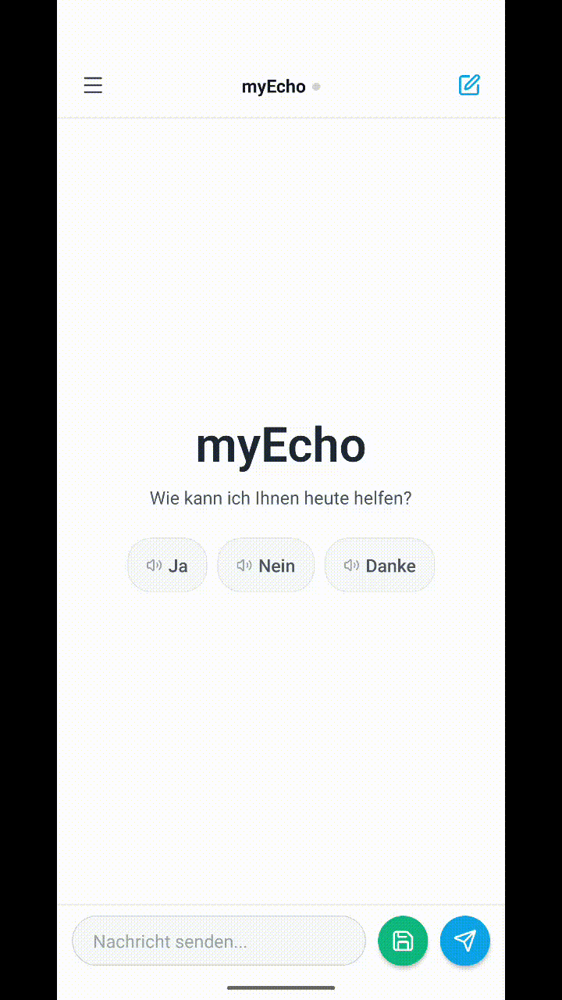
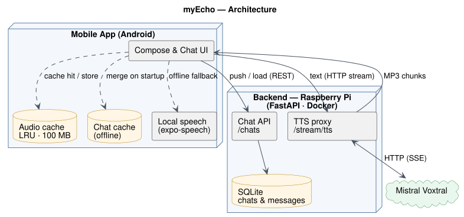

<div align="center">

🌐 **English** | [Deutsch](README.de.md)

# myEcho

## *"Giving a voice back to those who lost theirs."*

<br/>

**Assistive communication app for people with voice disorders.**

Type what you want to say — myEcho speaks it back in a natural AI voice.

<br/>


</div>

---

## Table of Contents

- [About](#about)
- [Demo](#demo)
- [How It Works](#how-it-works)
- [Project Structure](#project-structure)
- [Mobile App](#mobile-app)
- [Backend](#backend)
- [Monitoring](#monitoring)
- [CI/CD](#cicd)
- [Status](#status)

---

## About

**myEcho is built for people who can no longer use their own voice.**

Speaking can be exhausting, painful, or impossible — and existing solutions are often too complicated. myEcho is the opposite: a calm, simple interface where you type what you want to say and the app speaks it back in a natural voice. No friction. No complexity.

---

## Demo

<div align="center">



</div>

---

## How It Works

<div align="center">



</div>

> Diagram source: [`docs/architecture.puml`](docs/architecture.puml) (PlantUML). Regenerate with `java -jar plantuml.jar -tsvg docs/architecture.puml`.

1. User opens the compose field → backend pre-warms the Fish Audio connection
2. In **Schnell** mode (default), finished sentences are already synthesized while the user types; in **Eco** mode, synthesis starts only on send
3. User taps Send → the first sentence starts playing; the remaining sentences are prepared while it plays
4. App checks the on-device audio cache → cache hit plays instantly from local file
5. Cache miss: app requests audio via HTTP streaming from the self-hosted backend
6. Backend forwards text to Fish Audio and streams MP3 chunks back in real time
7. The MP3 is stored in the device cache so the next playback of the same phrase is instant
8. If the backend is unreachable, the app falls back to local speech synthesis automatically

Chats sync independently of audio:

- On startup the app loads chats from the backend and **merges** them with the local copy — nothing is overwritten, so existing history is never lost and survives a reinstall
- When a chat changes it is saved locally and pushed to the backend; if the backend is offline the local copy is used and synced on the next reachable start

---

## Project Structure

```
My-Echo/
├── backend/
│   ├── main.py                 FastAPI — TTS streaming + warmup + health + chats
│   ├── db.py                   SQLite persistence for chats & messages
│   ├── test_main.py            pytest suite (TTS + health)
│   ├── test_chats.py           pytest suite (chat endpoints)
│   ├── requirements.txt
│   ├── docker-compose.yml      Backend stack + persistent chat-DB volume
│   └── Dockerfile
├── mobile-app/
│   ├── app/                    expo-router screens
│   ├── components/             ChatArea, Sidebar, Message, PhraseBar
│   ├── context/                CloudStatusContext (health check + green dot), PhrasesContext
│   └── utils/                  tts, synthQueue, typingPrefetch(Core), speedMode, ttsCache,
│                               chatStorage, chatSync, phrases, split, stats, storage, config, types, ttsLog
├── monitoring/
│   ├── docker-compose.yml      Prometheus + Grafana stack
│   ├── prometheus/             Scrape config
│   └── grafana/                Dashboard + datasource provisioning
├── docs/
│   ├── PRIVACY.md / PRIVACY_EN.md   Privacy policy (published via GitHub Pages)
│   ├── adr/                    Architecture Decision Records
│   └── release-notes/          Release notes per version
└── .github/workflows/
    ├── android-pr-build.yml    Android build for PRs touching mobile-app/
    ├── android-merge-build.yml Android build + draft release on merge to main
    ├── android-release.yml     Signed APK/AAB build + GitHub Release (on tag)
    ├── mobile-ci.yml           npm ci + typecheck on every mobile-app push/PR
    ├── backend-deploy.yml      Docker image build + push to GHCR
    ├── backend-tests.yml       pytest + coverage badge
    └── pages.yml               Publishes the privacy policy to GitHub Pages
```

---

## Mobile App

### Features

- **Cloud TTS** — messages are spoken in a natural AI voice via Fish Audio
- **HTTP streaming** — playback starts immediately, no waiting for full audio
- **On-device audio cache** — repeated phrases play instantly from a local LRU cache (100 MB cap, evicts down to 80 MB); hit rate and size are visible on the stats screen
- **Pre-warming** — backend prepares the Fish Audio connection while the user is typing
- **Background playback** — speech keeps playing when the screen locks or the app goes to the background, so long messages finish uninterrupted
- **Automatic fallback** — switches to local speech synthesis when the backend is unavailable
- **Status indicator** — green dot in the header shows whether the cloud connection is active
- **Chat history sidebar** — create, pin, rename, and delete chats
- **Daily auto-chat** — a new chat is created automatically each day
- **Two send actions** — *Send* saves and auto-plays the message; *Save* stores it silently
- **Schnell / Eco switch** — *Schnell* (default) prepares speech while you type, so playback starts at once on send; *Eco* prepares it only on send and uses fewer voice-service requests. The choice is saved
- **Sentence-by-sentence playback** — long messages start with the first sentence; the next one is loaded while the current one plays, with no audible gap
- **Quick phrases** — a phrase bar above the input for one-tap speaking; phrases can be edited on their own screen
- **Per-message playback** — every bubble has a play/pause button
- **Copy message text** — long-press any message to copy its text to the clipboard
- **Edit in fullscreen** — tap the pencil on any message to edit it in a focused, distraction-free modal
- **Usage statistics** — tracks characters spoken and TTS response times
- **Backend chat sync** — chats and messages are saved to the backend database and merged with the local copy on startup, so history survives a reinstall
- **Offline cache** — chats are cached on-device as a local JSON file and used when the backend is unreachable

### Run Locally

Requires Node 24 LTS (matches CI and the Docker image).

```bash
cd mobile-app
cp .env.example .env   # EXPO_PUBLIC_BACKEND_URL auf die eigene Backend-IP setzen
npm install
npm start
```

For comparing against the old single-stream playback, set `EXPO_PUBLIC_SENTENCE_STREAMING=0` in `.env`.

---

## Backend

A lightweight FastAPI service that proxies streaming TTS requests to Fish Audio and persists chat history in a local SQLite database. Self-hosted on a Raspberry Pi, accessible via WireGuard VPN. Distributed as a Docker image via GHCR.

### Endpoints

| Method   | Path            | Description                                            |
|----------|-----------------|--------------------------------------------------------|
| `GET`    | `/stream/tts`   | Streams MP3 audio for `?text=...` via chunked HTTP (30/min per client) |
| `GET`    | `/warmup`       | Pre-warms Fish Audio connection before user sends      |
| `GET`    | `/health`       | Returns provider status, voice/model, and API credits  |
| `GET`    | `/chats`        | Returns all stored chats                               |
| `PUT`    | `/chats/{id}`   | Creates or updates a chat (upsert)                     |
| `DELETE` | `/chats/{id}`   | Deletes a chat                                         |
| `GET`    | `/metrics`      | Prometheus metrics endpoint                            |

### Configuration

| Variable      | Default          | Purpose                       |
|---------------|------------------|-------------------------------|
| `TTS_API_KEY`      | —                | Fish Audio API key            |
| `TTS_MODEL`        | `s2-pro`         | Model name                    |
| `TTS_VOICE`        | —                | Voice / reference ID          |
| `TTS_LATENCY`      | `balanced`       | `normal`, `balanced`, or `low`|
| `TTS_CHUNK_LENGTH` | `50`             | Tokens before first audio chunk (lower = faster TTFA) |
| `DB_PATH`          | `/data/chats.db` | SQLite chat database location |

### Deploy (Raspberry Pi via Portainer)

1. Portainer → **Stacks → Add stack → Web editor**
2. Paste content of `backend/docker-compose.yml`
3. Add environment variables above
4. Deploy — container exposes port `4444` and persists chats in the `myecho-data` volume (mounted at `/data`)

Updates: push to `main` → GitHub Actions builds new image → Portainer **Pull and redeploy**. The `myecho-data` volume is preserved across updates, so chat history is kept.

---

## Monitoring

Prometheus + Grafana dashboard self-hosted on the Pi. The Grafana URL is configured via `BACKEND_HOST` in `monitoring/.env`.

```bash
cp monitoring/.env.example monitoring/.env   # set BACKEND_HOST to your Pi IP
docker compose -f monitoring/docker-compose.yml up -d
```

Shows request rate, latency (p50/p95/p99), error rate and warmup hit rate.
The full stack lives in [`monitoring/`](monitoring/) — deploy `monitoring/docker-compose.yml` the same way as the backend; the Grafana dashboard and Prometheus datasource are provisioned automatically.

---

## CI/CD

| Workflow | Trigger | Result |
|---|---|---|
| `android-pr-build.yml` | PR touching `mobile-app/` | Android build for review |
| `android-merge-build.yml` | Push to `main` | Android build + draft GitHub Release |
| `android-release.yml` | Push tag `v*.*.*` (or manual run) | Signed APK/AAB attached to GitHub Release |
| `mobile-ci.yml` | Push & PR touching `mobile-app/` | `npm ci` + TypeScript typecheck |
| `backend-deploy.yml` | Push to `backend/` on `main` | Docker image pushed to GHCR |
| `backend-tests.yml` | Every push & PR | pytest run + coverage badge update |
| `pages.yml` | Push to privacy docs on `main` | Privacy policy published to GitHub Pages |

```bash
# Mobile release
git tag v2.0.1 && git push origin v2.0.1

# Backend deploys automatically on every push to backend/
```

---

## Status

The app is in active development, built for personal use.

Privacy policy: [German](https://seiferla.github.io/My-Echo/) · [English](https://seiferla.github.io/My-Echo/privacy-en.html)

---
This project is being developed with the help of Claude and other AI tools. 
