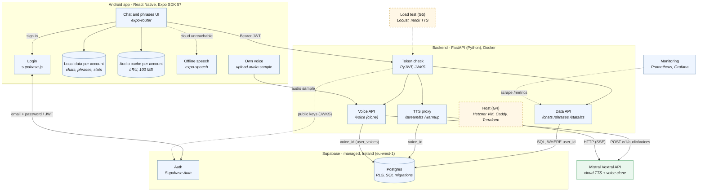
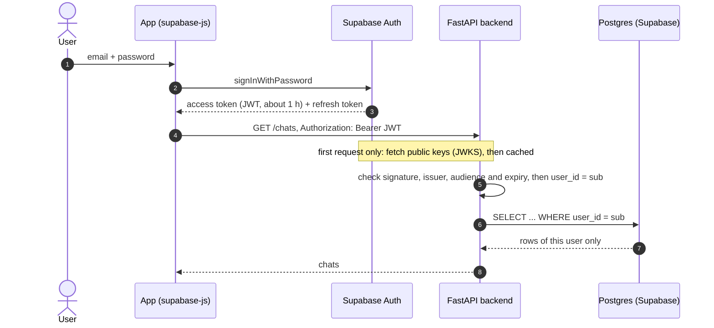

# myEcho Multi-User: Architecture

Status: 2026-10-28, branch `multiuser`. The diagrams are Mermaid code, GitHub renders them.
Solid boxes exist and run. Dashed boxes are planned (goal IDs from [goals.md](goals.md)).

The single-user version on `main` (Raspberry Pi, SQLite) is in
[myecho-architecture.svg](myecho-architecture.svg). It is not repeated here.

## Components and dependencies

## Login and a data request

The backend never sees the password and never handles refresh tokens. The app
refreshes the token itself.

## Inventory: what is used for what

| Component | Role | Technology / product | Where it runs | Status | Decision |
|---|---|---|---|---|---|
| Mobile app | UI, offline use | React Native 0.86, Expo SDK 57, expo-router | Android | done | |
| Login | Sign-in, session | Supabase Auth (managed), `supabase-js` | Supabase, Ireland | done | [ADR 0002](adr/0002-supabase-auth-and-database.md) |
| Token check | Verify the JWT, get `user_id` | PyJWT, ES256 / RS256 via JWKS | in the backend | done | ADR 0002 |
| Backend API | Chats, phrases, statistics, TTS proxy | FastAPI, Uvicorn, asyncpg | local / Docker | done | ADR 0002 |
| Database | Data per user | Supabase Postgres, RLS on every table | Supabase, Ireland | done | ADR 0002 |
| Schema | Versioned database changes | Supabase CLI, SQL files in `supabase/migrations/` | repo | done | |
| Speech | Text to speech | Mistral Voxtral API, model `voxtral-mini-tts-3-0` | Mistral cloud | done | |
| CI | Tests, Android builds | GitHub Actions, Postgres 17 for backend tests | GitHub | done | |
| Monitoring | Metrics | Prometheus, Grafana (`monitoring/`) | separate stack | done, `/metrics` is still public | |
| Hosting | VM, HTTPS, infrastructure as code | Hetzner VM, Docker Compose, Caddy, Terraform | Hetzner | planned (G4) | ADR 0002 |
| Passkeys | Sign-in without typing | `react-native-passkeys`, Supabase passkeys | app, Supabase | planned, 2-day spike (G1) | ADR 0002 |
| Own voice | Voice clone per user (upload + store `voice_id`) | Mistral `/v1/audio/voices`, `user_voices` table | Mistral cloud + Supabase | done (G3) | |
| Usage metering | Cost per user | table with one row per TTS request | Postgres | planned (G7) | |
| Mock TTS | Stands in for Mistral in load tests (silent MP3, set delay) | `TTS_PROVIDER=mock` in the backend | backend | done (G5) | |
| Load test | Scaling evidence | Locust | separate VM | planned (G5, G6) | |

## How to keep this current

1. Change the diagram and the table in the **same commit** as the code change.
2. A new technology or product gets a row here. A decision between options gets an ADR in `docs/adr/`.
3. Planned stays dashed or marked "planned" until it runs.
4. This file is the only source for the multi-user architecture. If a box and the code disagree, fix the box in the same pull request.
